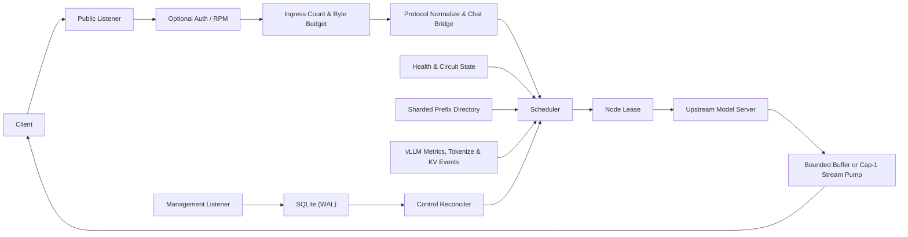

# Architecture

[Documentation Index](README.md) | [Configuration & Security](configuration.md) | [vLLM Provider](vllm.md)

Estuary runs a public inference data plane and a private management control plane in one process. Both share an in-memory `Scheduler`; SQLite (`node_configs`, `ip_limits`, `control_state`) is the sole durable store for configuration.



---

## Public Request Pipeline

1. **TCP accept & connection caps**: `BoundedTcpListener` enforces `ESTUARY_MAX_CONNECTIONS` and persisted per-IP connection limits (`ip_limits`), tracking accepted connections until their first request begins so graceful shutdown cannot race socket handoffs.
2. **Response tracking & request ID**: `track_public_response` installs a single `ObservedStream` wrapper for observability, session logging, and graceful-shutdown in-flight tracking; `assign_request_id` sets `x-request-id` (and `request-id` for Anthropic paths).
3. **Optional public auth & RPM**: When `ESTUARY_PUBLIC_API_KEYS` or `ESTUARY_PUBLIC_RPM_LIMIT` is set, requests are verified in constant time and checked against a bounded per-key/IP fixed-window limiter.
4. **Ingress admission**: Before reading the body of any `POST /v1/*`, Estuary acquires one request slot (`queue_max_requests`) and KiB-rounded byte permits (`queue_max_bytes`), reserving `Content-Length` (or `max_request_body_bytes` for chunked uploads). Exhaustion waits and applies transport backpressure instead of spawning unbounded work.
5. **Body read & budget shrink**: The request body is read under idle, total, and size limits, after which `adjust_bytes` immediately returns any over-reserved ingress byte permits.
6. **Compatibility & protocol bridge**: Estuary rejects unsupported stateful/lossy inputs, strips Claude Code billing blocks and no-op context edits, replaces images on `multimodal: false` models, and converts `/v1/messages*` and `/v1/responses` once into upstream `/v1/chat/completions` JSON.
7. **Prefix & exact tokenization**: Extracts canonical routing material and token workload estimates. For vLLM pools with authoritative exact KV directories and an approximate prefix match above `cache_threshold`, queries the shared tokenization LRU cache (with singleflight coalescing) via `control_client` (separate from the inference HTTP pool).
8. **Scheduling & FIFO lease acquisition**: Ranks eligible nodes and atomically acquires a node concurrency permit. When all eligible nodes are busy, the request registers cancel-safe acquisition futures across eligible nodes; Tokio FIFO semaphores prevent new arrivals from starving older waiters. Independent model pools share no global head-of-line lock, and registry/health/provider/circuit changes wake waiters.
9. **In-place dispatch & early byte release**: Patches only top-level `model` (and `return_mm_kwargs`/`stream` for `count_tokens`) in place without deep-cloning large prompt JSON, scrubs inbound credentials/hop-by-hop headers, injects node credentials, and forwards with redirects disabled. Once forwarded/headers received, `release_bytes` returns the ingress byte reservation (response buffering is bounded independently).
10. **Delivery & cleanup**: Non-streaming successes buffer within per-response and global response-buffer budgets (`ResponseBufferBudget`); streaming responses flow through a capacity-one `mpsc` pump owning the node lease until EOF, error, client cancel, or upstream/downstream timeout. Successful responses record approximate prefix ownership before releasing the lease.

---

## Scheduling Model

Each node's `max_concurrency` is a hard per-process cap. Eligible nodes (matching model, not draining, routable health/provider/circuit state, not excluded by retries, and fresh vLLM `waiting < waiting_threshold`) are scored; **lower scores win**:

```text
observed_load = max(local_active, fresh_vllm_running + fresh_vllm_waiting)
load          = ((observed_load + 1) / max_concurrency) / weight

prefill       = (pending_prefill_tokens + incoming_uncached_tokens) / prefill_token_scale / weight
decode        = (pending_decode_tokens  + incoming_output_tokens)   / decode_token_scale  / weight
latency       = recent_latency_ms / target_latency_ms
error         = error_ewma + health_penalty

score = load_weight    * load
      + prefill_weight * prefill
      + decode_weight  * decode
      + latency_weight * latency
      + error_weight   * error
```

- **Latency & health penalties**: Fresh observed TTFT EWMA is preferred over response-header latency; stale or absent samples contribute `0`. Health penalties are `0.0` (`healthy`), `0.15` (`starting`, when `route_while_starting=true`), and `0.35` (`degraded`). Ties rotate round-robin across candidates via an atomic tie-breaker rather than favoring lexicographically first node IDs.
- **Cache affinity & imbalance decay**:
  - An authoritative exact vLLM token match (including `0`) overrides approximate character history for that node and receives full credit even below `cache_threshold`.
  - Approximate character matches above `cache_threshold` receive at most `50%` credit, halving every `prefix.approximate_half_life_ms` since last recorded on that node, capped to the indexed prefix length.
  - Cache credit decays continuously as a node's normalized load exceeds the least-loaded eligible candidate:
    ```text
    excess_requests          = max(0, load - min_load) * max_concurrency * weight
    credit_divisor           = 1 + excess_requests / max(1, balance_abs_threshold) / balance_rel_threshold
    incoming_uncached_tokens = input_tokens - floor(cached_tokens * confidence / credit_divisor)
    ```
- **Workload accounting**: Each lease tracks its assigned prefill and estimated output work. The first observed generation event (text, reasoning, or tool output; never pings or metadata) clears pending prefill while keeping concurrency and decode reservations until EOF, failure, timeout, or cancellation. Input work uses exact token IDs when available, else a full-prompt text heuristic (~4 ASCII or ~1 non-ASCII char/token, excluding encoded media blobs). Output work uses recent reported per-completion output length (default `256` tokens), capped by the request's output token limit and multiplied by completion count (`n` and Completions batch size; `0` for Embeddings and `count_tokens`).

---

## Prefix & Exact KV Directories

- **Approximate `PrefixDirectory`**: Sharded in-memory compressed radix trees keyed by `(endpoint, public_model)` indexing canonical prompt-affecting fields (system/instructions, messages, tools, tool choice, response format, parallel tool calls, reasoning settings). Bounded globally by `max_trees` and `max_directory_chars`, per request by `max_request_chars`, and per node by `max_tree_chars_per_node` with recency eviction. Streaming requests record ownership after observed generation (with EOF fallback).
- **Exact `ExactCacheDirectory`**: Sharded per-node token-block directory maintained from vLLM ZMQ KV events; see [vLLM Provider](vllm.md#exact-kv-block-routing).

---

## Health, Circuit Breakers & Bounded Retries

- **Health monitor**: Runs jittered active HTTP probes against `health_path` (using `control_client` and node credentials). States are `starting`, `healthy`, `degraded`, and `unhealthy`. The first successful startup probe transitions `starting -> healthy`; failures degrade and then mark `unhealthy` after `unhealthy_threshold` active or `passive_failure_threshold` passive inference failures; recovery requires `healthy_threshold` consecutive probe successes. Upstream `429` signals overload rather than a health failure.
- **Circuit breaker**: Independent of health. Consecutive transport, 5xx, or body failures open the circuit for `circuit_open_ms`; afterwards up to `circuit_half_open_max_requests` real inference requests probe half-open state until `circuit_half_open_success_threshold` consecutive successes close it (any half-open failure reopens it).
- **Retries**: Bounded to `1`–`3` total attempts (`ESTUARY_RETRY_MAX_ATTEMPTS`), always choosing a different untried eligible node. Eligible before downstream commit on connect errors, configured `ESTUARY_RETRY_STATUSES`, or non-streaming body read/validation failures. Streaming responses never retry once upstream headers are accepted.

---

## Persistence, Live Updates & Control-Plane Reconciliation

SQLite runs in WAL mode with transactional migrations (`node_configs`, `ip_limits`, `control_state`). Triggers bump `control_state.revision` on every insert, update, or delete:

- **Live node replacement**: Updating a node creates a new configuration snapshot sharing the node's live resizable capacity semaphore, active count, and workload counters across generations. In-flight requests finish on their original immutable snapshot while new requests route to the updated snapshot. Health, request stats, and circuit state are preserved when the upstream engine configuration is unchanged; prefix/KV ownership is invalidated and vLLM monitors restart cleanly for the new generation.
- **Multi-process reconciliation**: Local processes sharing one SQLite database poll `control_state.revision` every `ESTUARY_CONTROL_SYNC_INTERVAL_MS` and reconcile added/updated/deleted nodes and `ip_limits` into their local runtime state. Every local change or reconciliation also broadcasts on `/admin/api/events` (SSE).

---

## Design Boundaries

- **Process-local runtime state**: Concurrency leases, queues, health, circuits, observability histories, RPM buckets, and prefix/KV directories are not replicated across separate hosts or containers.
- **Stateless Responses**: Background execution, `previous_response_id`, `conversation`, and `/v1/responses/{id}` are rejected because Estuary does not persist response-to-node state.
- **At-least-once retries**: Enabling retries can repeat upstream token generation or billing.
- **Separate data & control HTTP clients**: Inference traffic uses an unbounded-idle pool (`client`); health probes, vLLM scraping, and tokenization use a dedicated pool (`control_client`) so inference bursts cannot starve control operations.
